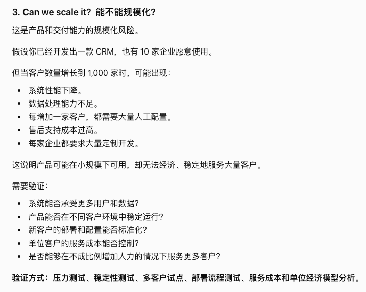
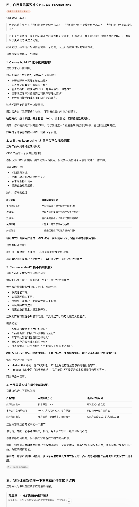

## 一、四层证据模型及其问题

第一、二、三层，主要是在收集客户信息、验证点子或发现点子。第四层，才开始把你的解决方案拿出来，测试客户是否愿意付费。

这也意味着，你不应该一开始就向客户介绍你的点子，而应该先通过前三层充分收集客户信息，等你确认问题存在、问题值得被解决，并且问题具有商业价值后，再进入第四层。

最终建议：以后每次做客户访谈，都按照这四层收集证据，但不要为了凑齐四层而强行提问。如果第一层就发现客户根本没有这个问题，就没有必要继续。如果第二层发现问题影响很小，也要谨慎。如果第三层没有任何资源投入，就需要进一步判断需求是否足够强。

并且要记住：**询问是为了搜集证据，而不是单纯把问题问出去，实际客户访谈中可能问题和答案都是层与层之间穿插着的，所以我们要练就的能力是“听到客户的回答后，能够识别自己已经获得了什么证据，以及下一步还需要收集什么证据”，而不是能背诵下来多少个访谈问题。而且我们最好也不要机械地只问这些问题，其它保持自然的问题该聊聊，只不过一定要记住自然的把这些问题问出去并收集到该收集的证据。**

#### 1、第一层证据——【客户存在问题】应该询问的问题

| 问题                                                                                                                                                                                                         | 用途                                           |
| ------------------------------------------------------------------------------------------------------------------------------------------------------------------------------------------------------------ | ---------------------------------------------- |
| “你每天的工作/生活中最重复且让你感到繁琐的事情是什么？”                                                                                                                                                      | **先探索客户目前最关心的、可能存在问题的领域** |
| “你近期的工作/生活中有什么关注的目标，有没有遇到什么困难或限制条件？”                                                                                                                                        | **先探索客户目前最关心的、可能存在问题的领域** |
| “你能不能口头描述甚至现场演示下你目前处理这件事情的工具和流程是怎样的”，聊聊整个过程中哪些环节让他们感到满意（他们在乎什么，我们就保留甚至加强什么），哪些环节让他们感到不爽（这就是问题，我们应该解决什么） | **然后再发现该领域内客户存在的问题**           |

#### 2、第二层证据——【客户存在痛点】应该询问的问题

| 问题                                                                                                                                                                                                                                               | 用途                                                                                                                                                                                                                                                                                                                                                                                                                                                     |
| -------------------------------------------------------------------------------------------------------------------------------------------------------------------------------------------------------------------------------------------------- | -------------------------------------------------------------------------------------------------------------------------------------------------------------------------------------------------------------------------------------------------------------------------------------------------------------------------------------------------------------------------------------------------------------------------------------------------------- |
| “你之前有没有寻找过解决办法来尝试解决这个问题？”  如果没有寻找过，继续询问“为什么没有寻找？”  如果寻找过，继续询问“之前你寻找的那些方案的主要问题在哪里？你是否正在寻找其它替代方案？如果是，卡在哪里？如果选择维持现状，为什么？“ | **验证问题是否严重到成为痛点——客户想主动解决**  如果客户之前从未寻找过解决办法，可能是觉得“问题不重要，不值得花精力解决”、也有可能是“习惯了现有的低效方式，不知道市场上还有更好的解决办法？”，如果回答的信息是问题对他们来说不是那么严重，就没必要继续往下询问了，否则可以继续询问  如果客户之前寻找过解决办法甚至目前仍在寻找解决办法，但是没找到满意的才选择了维持现状，可以视作他们目前的工具和流程就是那些不满意的，可以继续往下询问 |
| “这个问题如果不解决曾经造成过或可能会造成什么损失？”                                                                                                                                                                                               | **验证问题是否严重到成为痛点——问题不解决可能给客户造成多大损失**  这个答案能区分问题是“我愿意花钱解决”还是“确实有点烦，但无关紧要忍一忍也行”，我们最好能分清问题到底是哪种，也能**据此定价**                                                                                                                                                                                                                                                     |
| “如果解决这些问题，能产生多大价值？”                                                                                                                                                                                                               | **验证问题是否严重到成为痛点——问题解决可能给客户带来多大价值**  这也是定价的一点，常见的**定价原则是：根据产品为客户创造的价值来定价，而不是根据你的成本**                                                                                                                                                                                                                                                                                       |

#### 3、第三层证据——【客户存在强痛点】应该询问的问题

| 问题                                               | 用途                                                                                                                   |
| -------------------------------------------------- | ---------------------------------------------------------------------------------------------------------------------- |
| “目前处理这个问题需要投入多少时间和人工？”         | **验证问题是否严重到成为强痛点——客户是否已经在投入时间和人力来解决这个问题**                                           |
| “目前处理这个问题的人工、工具要花多少钱？”         | **验证问题是否严重到成为强痛点——客户是否已经在花钱来解决这个问题**  客户目前的支出，可以做为我们的**定价锚点** |
| “之前有没有购买过类似的产品或服务来解决这个问题？” | **验证问题是否严重到成为强痛点——客户是否曾经花过钱来解决这个问题**                                                     |
| “有没有采购更好解决方案的专门预算？”               | **验证问题是否严重到成为强痛点——客户是否准备花钱来解决这个问题**                                                       |
| 如果有预算的话，询问客户“谁最终拍板付款？”         | 我们必须弄清采购动的是谁的预算？公里还有谁有权让这笔交易泡汤？**客户存在强痛点，不代表客户上级愿意付钱**               |

#### 4、第四层证据——【客户是否愿意对你的点子采取实际行动】应该询问的问题（这个可以后面章节补充，就是进一步各种承诺）

| 问题                             | 用途                                                                                                                                       |
| -------------------------------- | ------------------------------------------------------------------------------------------------------------------------------------------ |
| “是否愿意参加具体的付费试点？”   | **初步付费意愿**                                                                                                                           |
| “是否愿意安排人员配合？”         | **实际资源投入**                                                                                                                           |
| “是否愿意提供必要的数据和权限？” | **合作意愿**                                                                                                                               |
| “是否愿意确定启动时间？”         | **实际行动意愿**                                                                                                                           |
| “是否愿意签署协议并付款？”       | **交易证据，直接请对方付钱，只有到手的定金和预购款能证明客户的问题是真实痛点。你完全可以问钱的问题，你是一家初创公司，没什么不好意思的。** |

## 二、关键问题

#### 1、什么问题是关键问题？

关键问题是好问题的子集，如果一个问题的答案可能彻底改变你接下来的商业决策，那它就是一个关键问题。比如有的问题的答案证明你的点子行不通，于是你就不干这个事了，那它就是个关键问题；比如有的问题的答案证明你的点子值多少多少钱，于是你就据此定价，那它就是个关键问题。反之，如果一个问题的答案不会改变你接下来的商业决策，那它就不是一个关键问题，无论这个问题的答案听起来是很正常还是很意外。

关键问题可能带来正面的答案，也可能带来负面的答案，而**关键问题的意义在于：你应该更加侧重于收集那些有可能彻底推翻你点子的证据，而不是不断收集那些支持你点子的证据，这样你就可以尽可能快且低成本地验证自己的点子到底可行不可行，从而避免在错误的方向上持续投入大量的时间和金钱。记住，你的目标是验证商业假设，而不是钓取虚假称赞，所以“负面的答案反而能带来最可靠的结果，正面的答案却仍需谨慎、进一步验证。”**

#### 2、怎么寻找和应用关键问题？

关键问题可能存在于四层证据模型的每一层，而绝不仅仅存在于高层。比如你通过第一层的问题发现客户根本不存在问题，那这个问题就是关键问题；比如你通过第二层的问题发现客户根本不在乎问题，那这个问题就是关键问题；比如你通过第三层的问题发现客户根本不想花钱解决问题，那这个问题就是关键问题；比如你通过第四层的问题发现客户根本不想和你进一步合作，那这个问题就是关键问题。你可以通过两个方向的思想实验来寻找那些可能决定创业成败的关键问题：

* 先假设公司已经失败了，问问自己最有可能是什么原因导致失败

* 再假设公司取得巨大成功了，问问自己要走到那一步必须满足哪些条件

**每次**客户访谈，你都应该提出**至少一个**有可能**证明你的点子行不通**的关键问题，**虽然这类关键问题得到的答案很可能会证明你的点子根本行不通，让你在自尊上备受打击，以至于你一直不敢问，但你必须问**。如果你能想到多个那就问多个，但更多时候你一下子想不到那么多，那就问眼下能想到的那一个、但至少得有一个，也就是说这类关键问题不是在一开始就全部想出来的，而是随着点子的不断演进逐渐浮现出来的。

## 三、市场风险和产品风险是什么？

市场风险主要回答**客户想要我们的产品吗？”、“客户愿意为我们的产品付费吗？”、“这样的客户够多吗？”**。四层证据模型里的问题可以收集“客户想要我们的产品吗？”和“客户愿意为我们的产品付费吗？”的证据，**但是“这样的客户够多吗？”就不是靠客户访谈来得到证据了，而是需要进行市场调研，也就是说我们首先要明确我们的目标客户画像到底是什么、然后我们在做下市场调研到底有多少这类客户、判断这些客户到底有多少可能转化为我们的付费用户以支撑这门生意，这个后续“市场调研”再补充，就好像老板推断教堂客户群和大概有多少成为付费用户。**

也就是说，我们前面提到的关键问题其实都是用来验证市场风险的，但除了市场风险以外，我们也需要一些关键问题用来验证产品风险。

产品风险主要回答**“我们能把产品做出来吗？”（**验证方式：技术原型、概念验证（PoC）、技术测试、实际数据迁移测试。**）、“我们能让客户持续使用产品吗？”（**验证方式：真实用户测试、MVP 试点、实际使用行为、留存率和持续使用情况。**）、“我们能把产品规模化吗？（**验证方式：压力测试、稳定性测试、多客户试点、部署流程测试、服务成本和单位经济模型分析。**）”。这几个问题又通过什么阶段、什么方式收集证据呢？之前有个问题是“你们的方案迁移成本如何”之类的，可以验证“我们能让客户持续使用产品吗？”，但是应该更系统总结这些问题。**

客户访谈主要帮助我们降低市场风险，而不是产品风险，所以验证了市场风险之后，千万别忘了问一问自己产品风险高不高，如果产品风险很高，就尽早动手构建产品、验证技术可行性，先把“我们能把它做出来吗？”这一步搞定，“我们能让客户持续使用它吗？”、“我们能把它规模化吗？”这两步是我们交付了第一版后再考虑的事情，根据实际情况调整产品让客户持续使用，并考虑如何做增长。

## 仍需补充

这里还要区分两个概念：

- Market Risk 中的「客户够多吗」：市场上是否存在足够多的潜在付费客户。

- Product Risk 中的「能规模化吗」：我们能否以可接受的成本和质量服务更多客户。

两者不是一回事。

