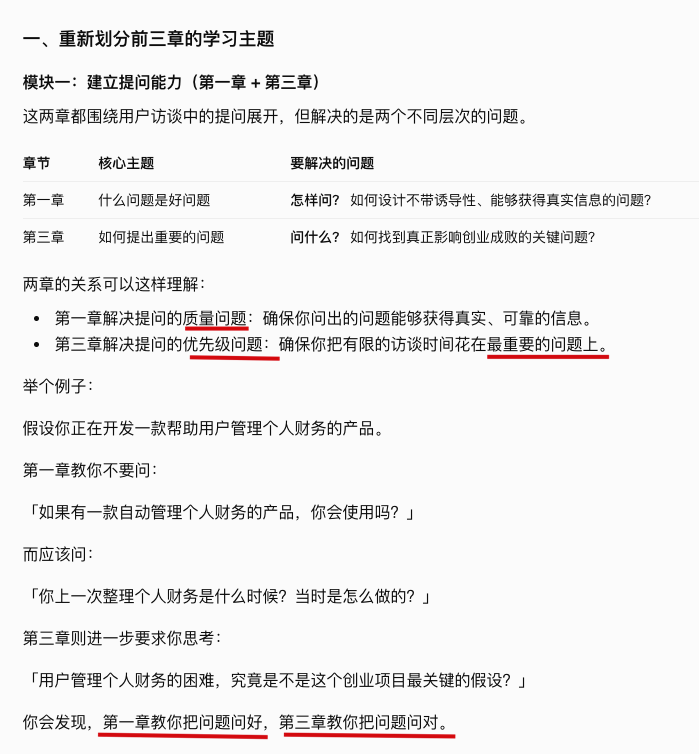

第3章：Asking Important Questions

学习目标：不仅会提问，还知道哪些问题最值得问。

阅读时思考：

1、什么是 Important Questions？

哪些有可能推翻我们点子的问题就是关键问题。

2、为什么创业者应该提前准备最重要的三个学习目标？

可以通过三个关键问题一步一步地验证自己点子到底是不是可行，也为了在一些偶遇的机会时自己已经形成了关键问题清单、不至于错过这些机会

3、什么是 Product Risk 和 Market Risk？

产品风险主要是自己这边的风险，能不能做出来客户想要的产品、能把它做大吗、肯不肯持续使用你的产品？

市场风险主要是客户那边的风险，客户到底想不想要你的产品、肯不肯花钱买你的产品、这样的客户够多吗？

4、如何判断自己当前最需要验证的风险？

如果觉得产品能做出来，那就优先去验证市场风险。如果觉得市场没问题，那就优先去验证产品风险。

5、如何避免提出很多问题，却没有回答最重要的商业问题？

每次客户访谈钱提前准备，一定要包含最重要的商业问题。

读完后，请向我回答：

- 什么样的问题才算重要问题？同 1

- Product Risk 和 Market Risk 有什么区别？同 3

- 为什么作者建议准备三个最重要的问题？同 2

- 假设你要开发一个 CRM 产品，你认为最需要验证的三个问题是什么？为什么？

  - 问题 1：我要面向什么客户，这些客户到底需要解决什么场景下的什么问题

  - 问题 2：客户到底需要不需要解决这个问题，愿意花钱解决吗

  - 问题 3：大概有多少这样的客户

  - 原因：因为做一个 CRM 系统不是什么难事，不存在产品风险，所以关键是市场风险，我们应该优先问市场风险相关的问题

实战任务： 给定一个创业点子，我让你设计三个最重要的访谈问题，并解释它们分别在验证什么假设。

