## 两个重要用途

发现机会和验证想法。

## 不是必须最近一次

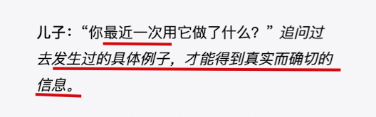

“最近一次”不是必须，核心是过去发生过的具体例子

## 证据

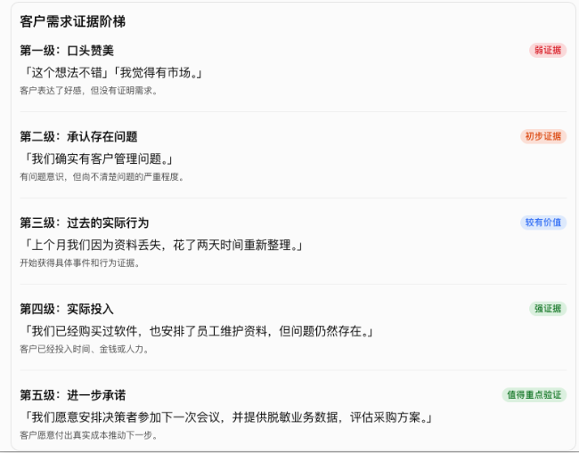

## 为了获取不同阶段的证据，应该设计针对该阶段的问题

下面只是之前顺带搜集了一下，并不系统，应该系统总结下

| 问题                                        | 好问题 / 坏问题 | 原因                   | 如何改进                                                                                                                                                                                                                                                                                                                                                                                                                                                                                                                                                                                                                                                                                                                                                                                                                                                                                                                                       |
| ------------------------------------------- | --------------- | ---------------------- | ---------------------------------------------------------------------------------------------------------------------------------------------------------------------------------------------------------------------------------------------------------------------------------------------------------------------------------------------------------------------------------------------------------------------------------------------------------------------------------------------------------------------------------------------------------------------------------------------------------------------------------------------------------------------------------------------------------------------------------------------------------------------------------------------------------------------------------------------------------------------------------------------------------------------------------------------- |
| “你觉得这是个好点子吗？”                    | 坏问题          | 在谈论自己的点子       | 这些问题主要用来获取“点子可行”的初级证据——问题是否存在： 1、可以请他们口头描述甚至现场演示下目前处理某件事情的工具和流程是怎样的，聊聊整个过程中哪些环节让他们感到满意（他们在乎什么），哪些环节让他们感到不爽（这就是问题）                                                                                                                                                                                                                                                                                                                                                                                                                                                                                                                                                                                                                                                                                                               |
| “如果有一种产品能实现 X，你会买吗？”        | 坏问题          | 在谈论自己的点子       | 用来获取“点子可行”的进阶证据——问题是否是个候选痛点：  问题是否真得严重？ 1、请他们口头描述甚至现场演示目前是怎么处理这个问题的，这样做花多少钱、耗费多少时间和人工，喜欢和讨厌哪些地方（客户目前的支出，可以做为我们的定价锚点） 2、这个问题不处理或处理出错曾经造成过或可能会造成什么损失？（这个答案能区分问题是“我愿意花钱解决”还是“确实有点烦，但无关紧要忍忍也行”，我们最好能分清问题到底是哪种，也能据此定价） 3、如果解决这些问题，能产生多大价值（这也是定价的一点。常见的定价原则是：根据产品为客户创造的价值来定价，而不是根据你的成本。） 4、询问他们在敲定目前这套方案之前，还尝试过哪些方案（如果客户此前从未寻找过解决办法，今后也不会来寻找——更不会购买——你的办法） 5、之前如果寻找过，那可以询问他们是否正在寻找替代方案？如果是，卡在哪里？如果选择维持现状，为什么？是因为寻找过替代方案但没找到满意的，还是根本不在乎，连搜都懒得搜一下  是否有改变意愿？ 1、换用新方案又有多麻烦？ |
| “你愿意花多少钱购买 X？”                    | 坏问题          | 在谈论自己的点子       | 如果进展已经足够深入，用来获取“点子可行”的最终证据——候选痛点是否是个真实痛点： 1、有没有采购更好解决方案的预算？ 2、如果有预算的话，询问用户“这笔钱从哪个预算出？”我们必须弄清采购动的是谁的预算？公里还有谁有权让这笔交易泡汤？ 3、直接请对方付钱，只有到手的定金和预购款能证明客户的问题是真实痛点                                                                                                                                                                                                                                                                                                                                                                                                                                                                                                                                                                                                                               |
| “你梦想中的产品能做什么？”                  | 坏问题          | 在询问客户对未来的想法 | 还是问过去发生过的真实事件，来发现真实需求                                                                                                                                                                                                                                                                                                                                                                                                                                                                                                                                                                                                                                                                                                                                                                                                                                                                                                     |
| “你为什么还要费这个劲？”                    | 好问题          | 在询问客户的过去       | 类似于询问客户“如果选择维持现状，为什么？”                                                                                                                                                                                                                                                                                                                                                                                                                                                                                                                                                                                                                                                                                                                                                                                                                                                                                                     |
| “这会造成什么后果？”                        | 好问题          | 在询问客户的过去       |                                                                                                                                                                                                                                                                                                                                                                                                                                                                                                                                                                                                                                                                                                                                                                                                                                                                                                                                                |
| “请具体讲讲上一次发生这种情况时的经过。”    | 好问题          | 在询问客户的过去       |                                                                                                                                                                                                                                                                                                                                                                                                                                                                                                                                                                                                                                                                                                                                                                                                                                                                                                                                                |
| “请带我过一遍你的工作流程。”                | 好问题          | 在询问客户的过去       |                                                                                                                                                                                                                                                                                                                                                                                                                                                                                                                                                                                                                                                                                                                                                                                                                                                                                                                                                |
| “你还试过哪些办法？”                        | 好问题          | 在询问客户的过去       |                                                                                                                                                                                                                                                                                                                                                                                                                                                                                                                                                                                                                                                                                                                                                                                                                                                                                                                                                |
| “如果一种产品能实现 Y，你愿意花 X 购买吗？” | 坏问题          | 在谈论自己的点子       |                                                                                                                                                                                                                                                                                                                                                                                                                                                                                                                                                                                                                                                                                                                                                                                                                                                                                                                                                |
| “你现在是怎么处理这个问题的？”              | 好问题          | 在询问客户的过去       |                                                                                                                                                                                                                                                                                                                                                                                                                                                                                                                                                                                                                                                                                                                                                                                                                                                                                                                                                |
| “这笔钱从哪个预算出？”                      | 好问题          |                        |                                                                                                                                                                                                                                                                                                                                                                                                                                                                                                                                                                                                                                                                                                                                                                                                                                                                                                                                                |
| “我还应该和谁谈谈？”                        | 好问题          |                        | 每次访谈结束时都应该问一下这个问题。最初几次谈话可能很那约到，但只要你们的访谈进行地愉快，你待人也得体，别人一介绍，你的线索很快会成倍增加。如果客户不愿意替你介绍，也没关系，别再打扰他，你至少获得了一条信息：很可能对方根本不关心他们存在的问题                                                                                                                                                                                                                                                                                                                                                                                                                                                                                                                                                                                                                                                                                             |
| “还有什么是我本来应该问、却没有问的吗？”    | 好问题          |                        | 通常访谈结束时，对方已经明白你想做什么。如果你不熟悉某个行业，所以即使你彻底漏掉了最重要的一点，他们也常常安静的坐在那里。而一旦你问出这个问题，就给了对方一个机会，让他们可以礼貌地“纠正”你的提问方向，而且他们真得会纠正。随着你越来越会提问、也越来越了解这个行业，自然就不在需要问这个问题。人们愿意帮助你，但除非你给他们一个顺理成章的机会，否则他们很少主动出手                                                                                                                                                                                                                                                                                                                                                                                                                                                                                                                                                                         |

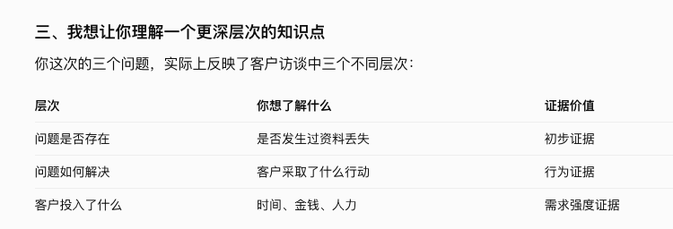

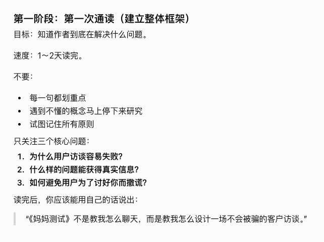

本书的核心目标：教会我们如何正确地跟客户交谈，并得到真实需求。正确的交谈就是提出好问题

为什么用户访谈容易失败？因为问的问题不对，导致获得了很多“假正面”的信号

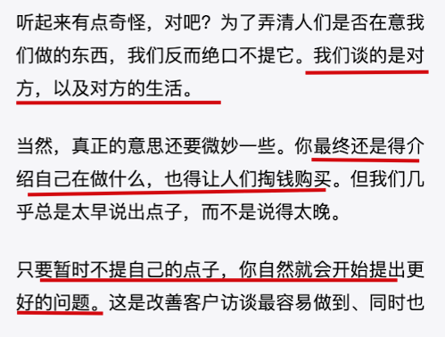

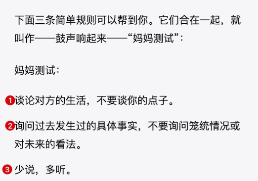

可以搜集一些好问题和坏问题，正反面的问题，以及我们要通过这个问题和行为得到什么信息

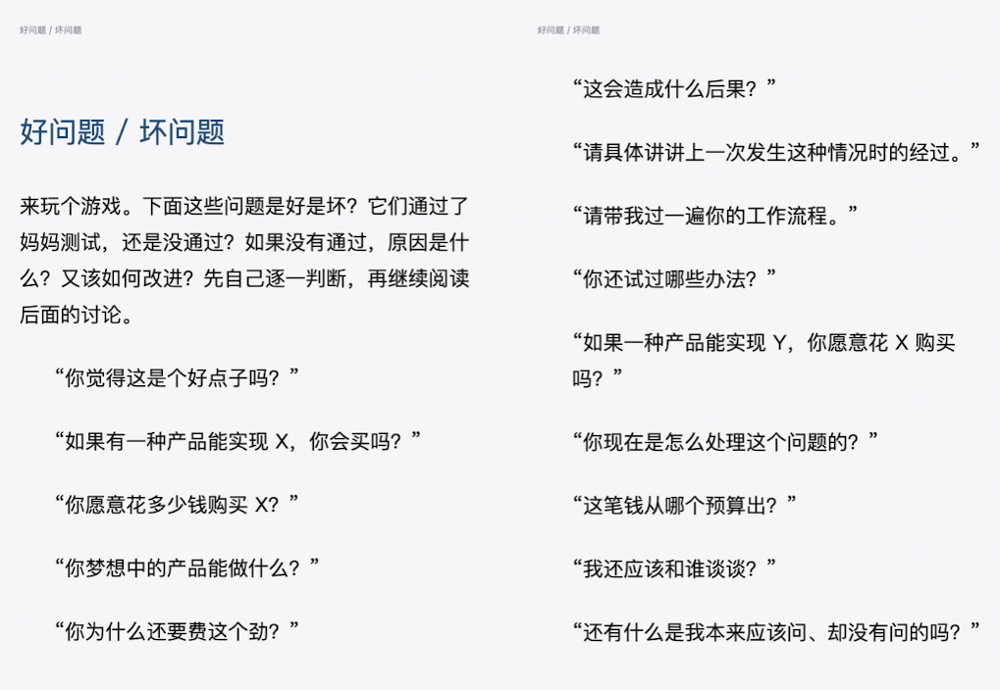

直接演示，聊问题、发现潜在需求

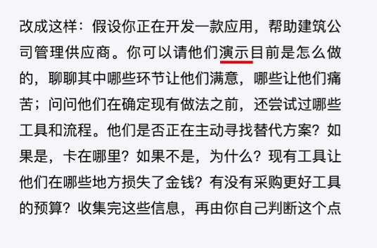

聊潜在需求到底算不算真实需求，判断他们愿不愿意花钱

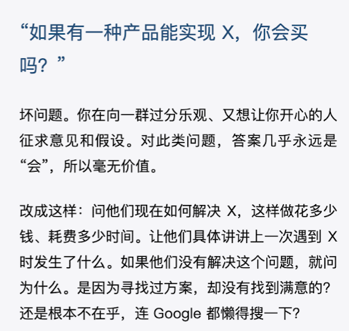

聊真实需求的预算

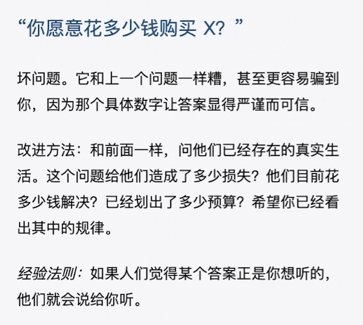

直接要需要，判断其背后的真实需求

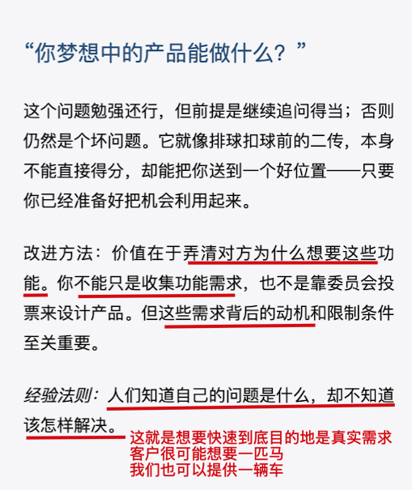

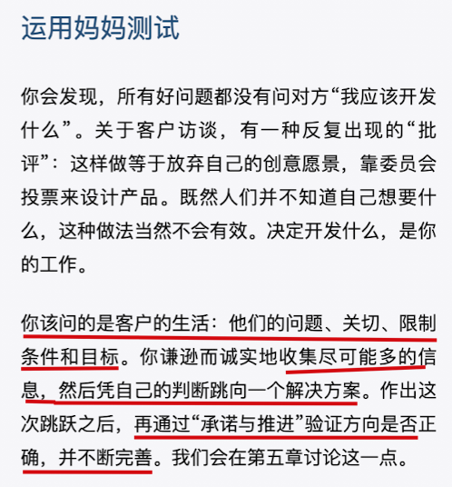

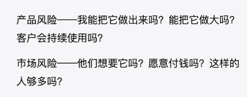

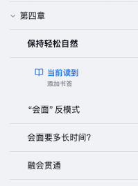

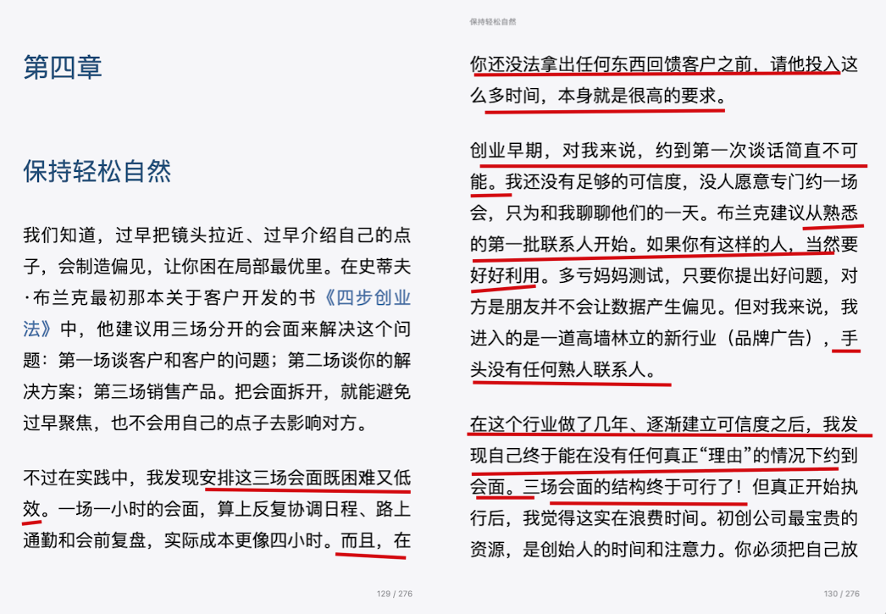

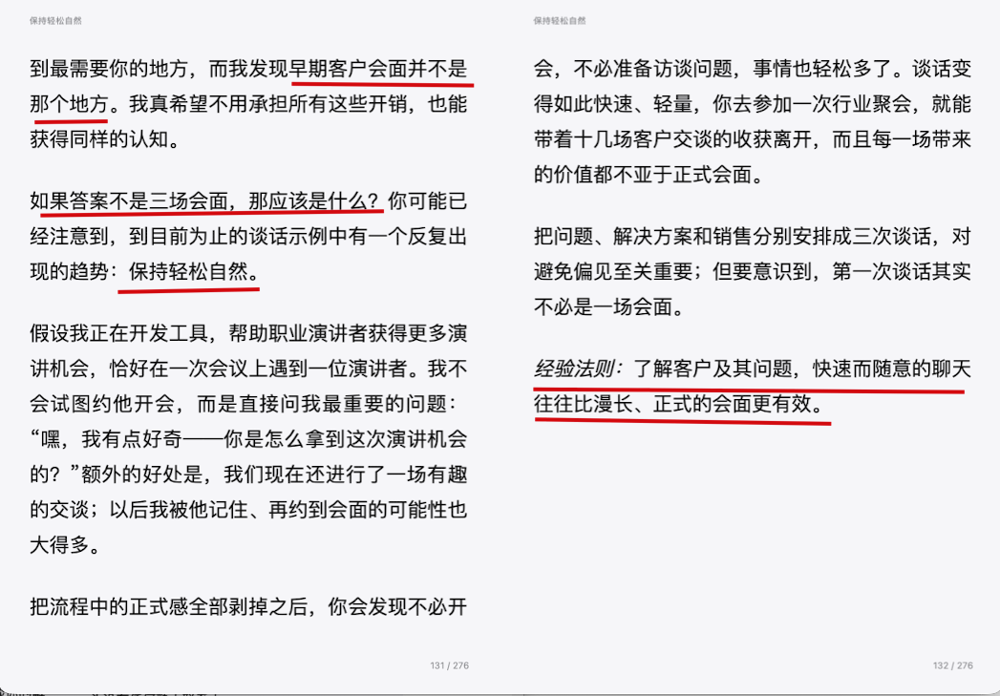

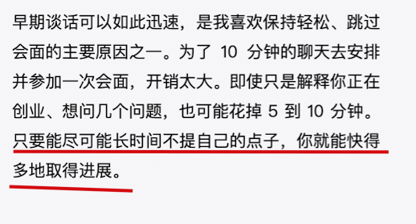

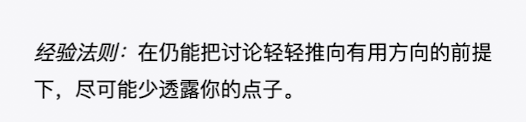

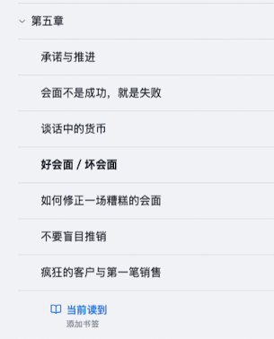

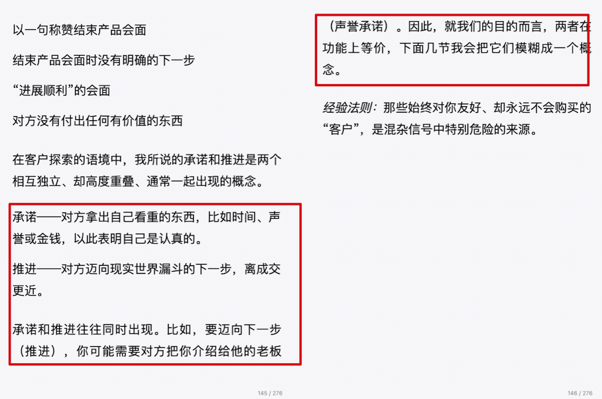

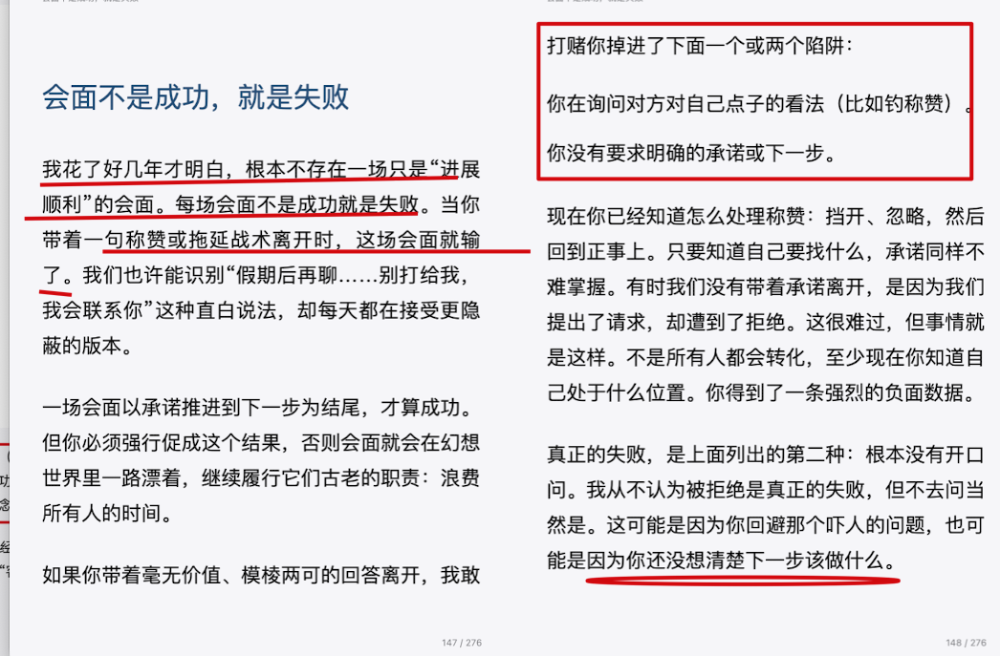

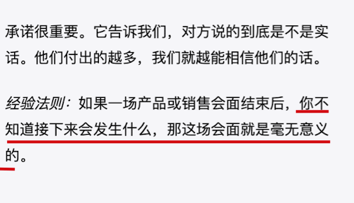

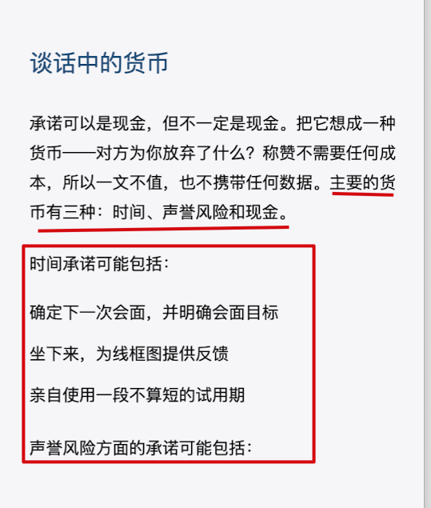

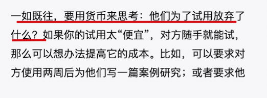

要思考他们放弃了什么

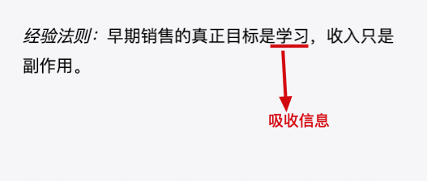

## 目录

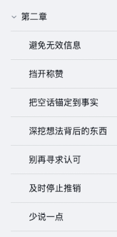

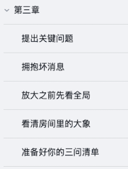

## 其它书籍：

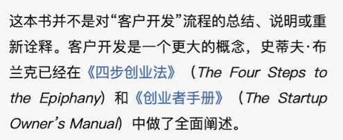
