> 做访谈的目标是什么？是这两个重要用途吗：发现机会和验证想法。
>
> 我不希望你第二遍读完，最后只得到一份漂亮的读书笔记。
>
> 我希望最终能帮你建立一套自己的客户访谈操作体系：
>
> - 知道访谈前应该准备什么。
>
> - 知道面对客户应该问什么。
>
> - 知道客户回答什么时应该继续追问。
>
> - 知道如何识别假阳性信号。
>
> - 知道如何判断需求是否值得继续验证。
>
> - 知道访谈结束后应该采取什么行动。

## 二、每一章的具体阅读任务

下面是最重要的部分。你可以直接把这些问题当成第二遍阅读时的阅读指南。

### 第2章：Avoiding Bad Data

学习方向二：信息判断

学习目标：识别错误信息，并学会纠正访谈方向。

这是我们之前诊断中发现的薄弱环节，需要重点精读。

阅读时思考：

1. 作者提到的三种 Bad Data 分别是什么？

2. 为什么客户的赞美不能证明需求？

3. 什么是 Fluff？它有哪些典型表现？

4. 为什么客户提出的功能建议不一定代表真实需求？

5. 当客户开始给出模糊、假设性或者恭维性的回答时，应该如何处理？

读完后，请向我回答：

- 分别解释 Compliments、Fluff、Ideas。

- 每一种 Bad Data 举两个实际例子。

- 如果客户说「这个产品很好，我肯定会用」，你如何回应？

- 如果客户说「我们通常都这么做」，你如何追问？

- 如果客户提出一个功能需求，你如何挖掘背后的真实动机？

实战任务： 我会给你一段包含多种错误信号的访谈记录，让你找出问题并设计纠偏方式。

注意：第2章的主要任务是判断信息质量，而不是训练你从零设计好问题。追问只是纠偏手段。

### 第3章：Asking Important Questions

学习方向一：提问设计

学习目标：不仅会提问，还知道哪些问题最值得问。

阅读时思考：

1. 什么是 Important Questions？

2. 为什么创业者应该提前准备最重要的三个学习目标？

3. 什么是 Product Risk 和 Market Risk？

4. 如何判断自己当前最需要验证的风险？

5. 如何避免提出很多问题，却没有回答最重要的商业问题？

读完后，请向我回答：

- 什么样的问题才算重要问题？

- Product Risk 和 Market Risk 有什么区别？

- 为什么作者建议准备三个最重要的问题？

- 假设你要开发一个 CRM 产品，你认为最需要验证的三个问题是什么？为什么？

实战任务： 给定一个创业点子，我让你设计三个最重要的访谈问题，并解释它们分别在验证什么假设。

### 第4章：Keeping It Casual

学习方向三：访谈对象与对话

学习目标：学会自然地开展客户交流。

阅读时思考：

1. 为什么客户访谈应该保持自然？

2. 正式访谈和自然交流有什么区别？

3. 如何避免让客户感觉自己正在接受调查？

4. 如何在自然交流中保持访谈方向？

5. 什么情况下应该控制访谈时间和节奏？

读完后，请向我回答：

- 为什么作者强调 Keep It Casual？

- 自然交流是否意味着不需要提前准备？为什么？

- 如果客户一直在聊无关话题，你会如何把交流拉回来？

- 如果客户一直询问你的产品，你会怎么处理？

实战任务： 我扮演一位潜在客户，你负责开启一场自然的客户访谈。

### 第5章：Commitment and Advancement

学习方向四：访谈推进与管理

学习目标：区分客户的口头兴趣和真实承诺，推动下一步进展。

阅读时思考：

1. 什么是 Commitment？

2. 什么是 Advancement？

3. 客户口头说愿意购买，为什么不一定是真正的承诺？

4. 客户愿意付出哪些东西，才能说明他认真对待这件事？

5. 如何让一次客户交流产生实际进展？

读完后，请向我回答：

- Commitment 和 Advancement 有什么区别？

- 什么样的承诺具有价值？

- 时间、金钱、信誉等投入分别意味着什么？

- 如果客户说「等你做好了告诉我」，你应该怎么处理？

- 如何设计一次访谈的下一步行动？

实战任务： 我给你五种客户反馈，你判断它们属于赞美、口头承诺、实际承诺还是 Advancement，并设计下一步行动。

### 第6章：Finding Conversations

学习方向三：访谈对象与对话

学习目标：找到愿意交流且值得交流的客户。

阅读时思考：

1. 如何找到潜在客户？

2. 如何获得客户引荐？

3. 如何邀请客户参加访谈？

4. 如何向客户解释访谈的目的？

5. 什么时候应该主动去客户所在的地方交流？

读完后，请向我回答：

- 如果你没有潜在客户资源，如何找到第一批访谈对象？

- 如何设计一段客户邀约信息？

- 如何让客户愿意接受交流？

- 如何判断一次访谈是否值得安排？

实战任务： 为一个具体创业点子，设计找到前10位潜在访谈对象的方法，并写出邀约方案。

### 第7章：Choosing Your Customers

学习方向三：访谈对象与对话

学习目标：学会客户细分，找到最值得服务的客户群体。

阅读时思考：

1. 为什么不能把所有潜在客户混在一起？

2. 什么是 Customer Slicing？

3. 如何从一个宽泛的客户群体逐渐缩小范围？

4. 如何选择最有价值的目标客户？

5. 如果产品涉及使用者、购买者和决策者，应该如何处理？

读完后，请向我回答：

- 什么是客户细分？为什么重要？

- 如何把「所有中小企业」细分成一个具体客户群体？

- 选择目标客户应该考虑哪些因素？

- 如何判断自己细分得太宽或太窄？

- 使用者、购买者和决策者可能不同时，应该访谈谁？

实战任务： 给你一个宽泛的市场，让你进行 Customer Slicing，最终确定第一批应该访谈的客户。

### 第8章：Running the Process

学习方向四：访谈推进与管理

学习目标：建立完整、可重复的客户访谈工作流程。

阅读时思考：

1. 访谈前应该做哪些准备？

2. 如何准备三个重要学习目标？

3. 访谈中应该如何记录信息？

4. 访谈结束后如何 Review？

5. 如何把客户反馈转化为下一轮行动？

读完后，请向我回答：

- 一次完整的客户访谈应该包含哪些阶段？

- 访谈前应该准备什么？

- 如何区分客户原话、事实、假设和自己的判断？

- 为什么要及时与团队分享访谈结果？

- 如何根据本次访谈调整下一次访谈的三个重要问题？

实战任务： 我们一起建立一份可以实际使用的客户访谈 SOP。

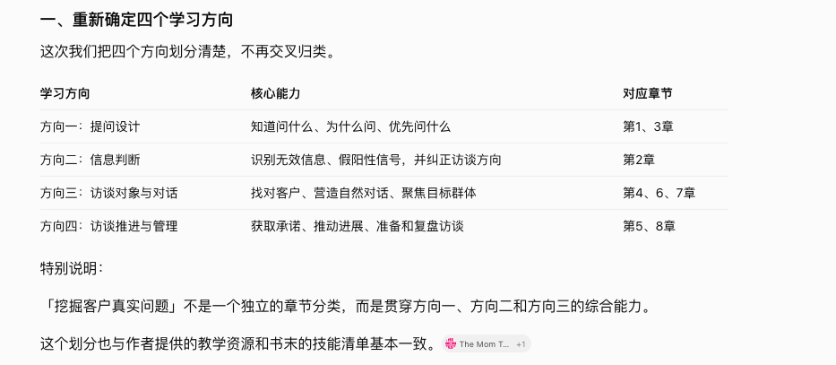

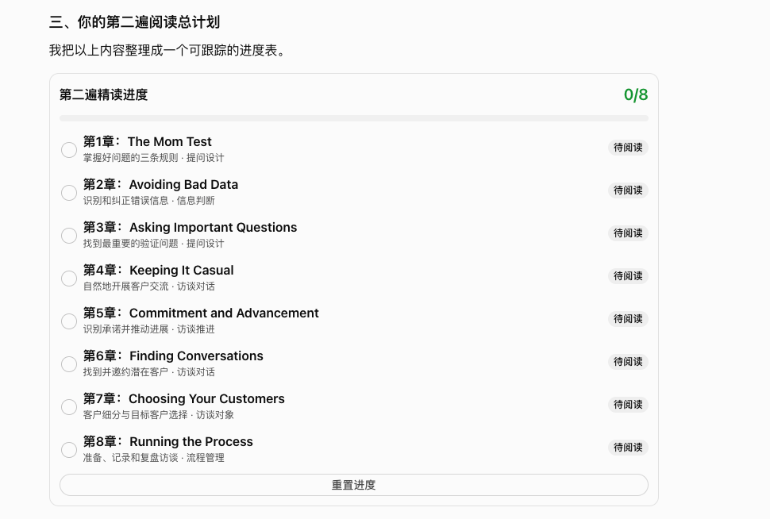

# 《妈妈测试》第二遍精读记录

**章节：** 第 X 章

### 1. 我的理解

这一章最重要的观点是什么？作者想解决什么问题？

### 2. 核心知识点

我认为这一章最重要的 3～5 个知识点是什么？

### 3. 我的困惑

哪些观点没有理解？哪些地方觉得反直觉？

### 4. 我的应用

如果我明天就要做客户访谈，我会如何应用这一章的知识？

### 5. 我的疑问

我还希望进一步讨论的问题是什么？

## 第一章：什么是好问题

> 为什么这么说？糟糕的客户访谈不只是没用，更危险的是，它会让你确信自己走在正确的路上。它给你一个“假阳性”信号，让你误以为方向正确，继而投入过多资金、时间和团队资源。

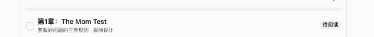

作者说了什么？作者为什么这么说？在什么场景下应该怎么用？

学习方向一：提问设计

学习目标：掌握什么是好问题。

阅读时思考：

1. 作者提出的 Mom Test 三条规则分别是什么？

2. 为什么不能谈论自己的产品，而应该谈论客户的生活？

3. 为什么询问过去发生的具体事情，比询问未来的想法更可靠？

4. 为什么访谈时应该少说多听？

5. 一个好的访谈问题需要满足什么条件？

读完后，请向我回答：

- 用自己的话解释 Mom Test 三条规则。

- 举出三个你认为不好的访谈问题，并分别改写。

- 你认为一个好问题最重要的特征是什么？为什么？

实战任务： 我会给你5个错误问题，让你逐一改写。

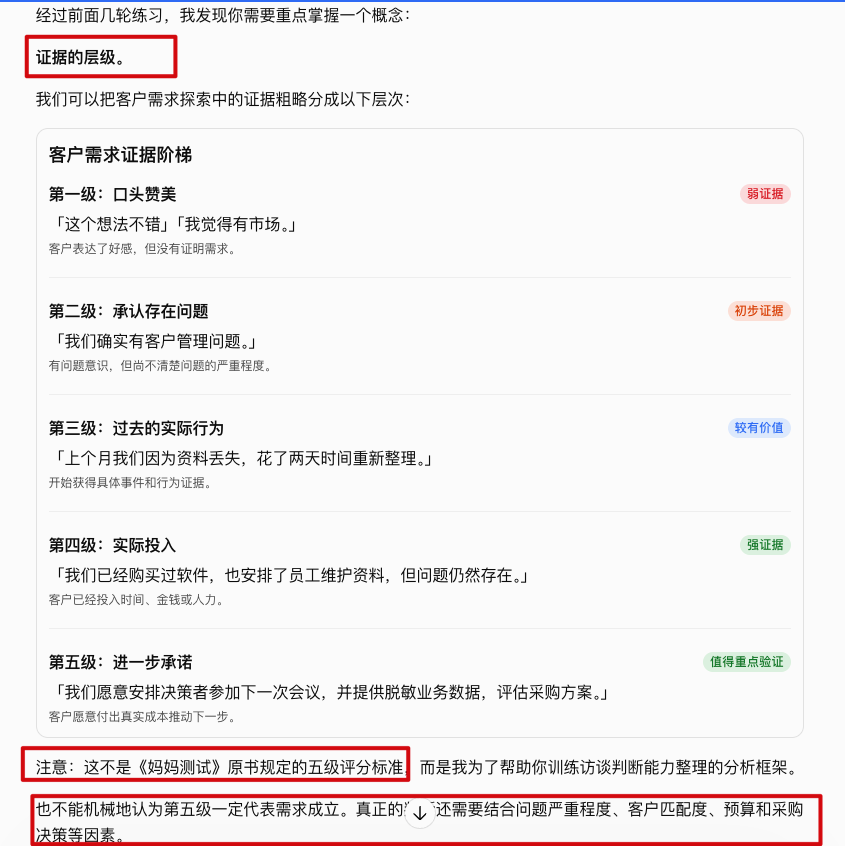

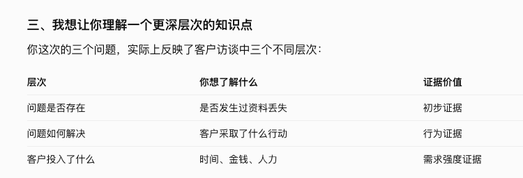

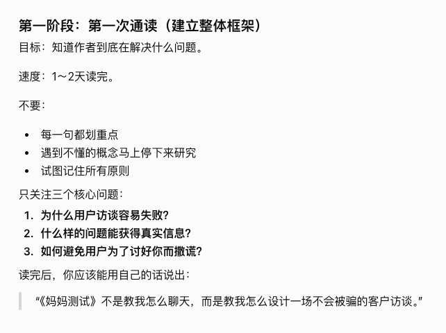

本书的核心目标：教会我们如何正确地跟客户交谈，并得到真实需求。正确的交谈就是提出好问题

为什么用户访谈容易失败？因为问的问题不对，导致获得了很多“假正面”的信号

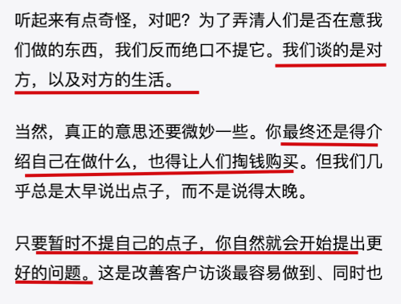

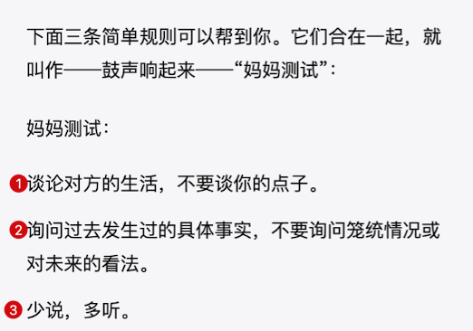

可以搜集一些好问题和坏问题，正反面的问题，以及我们要通过这个问题和行为得到什么信息

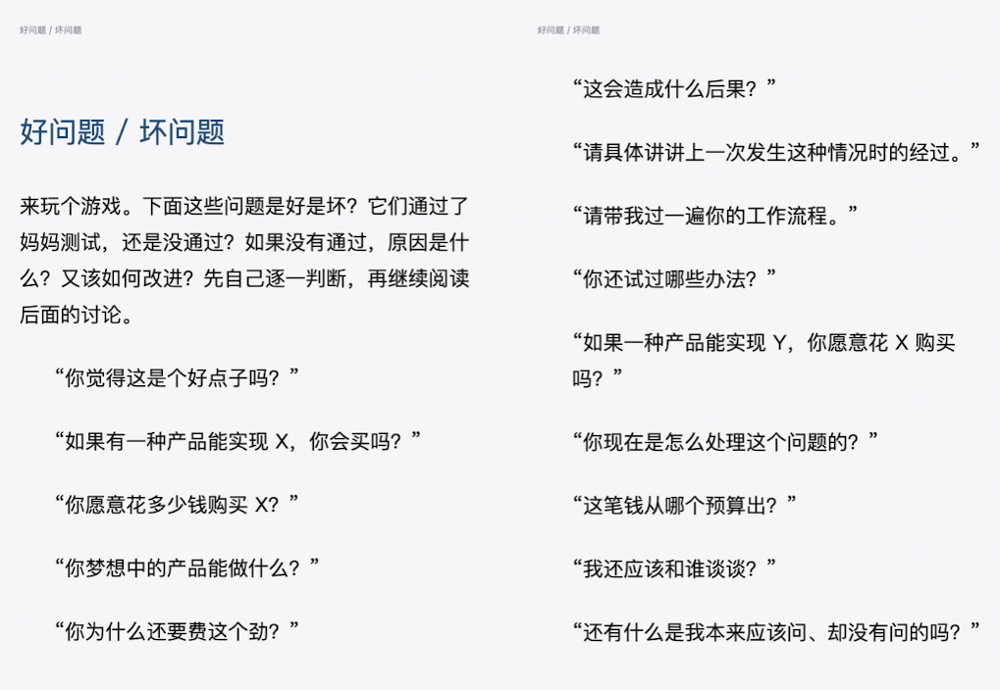

直接演示，聊问题、发现潜在需求

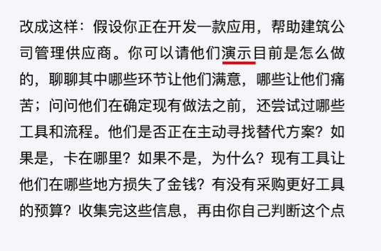

聊潜在需求到底算不算真实需求，判断他们愿不愿意花钱

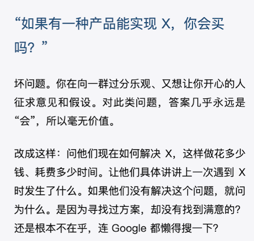

聊真实需求的预算

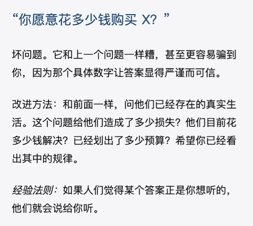

直接要需要，判断其背后的真实需求

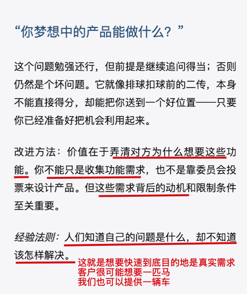

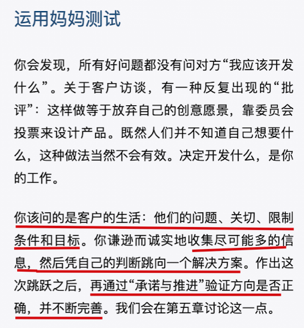

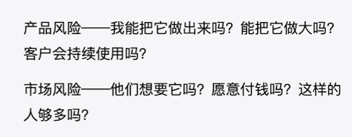

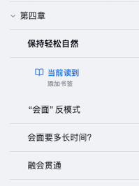

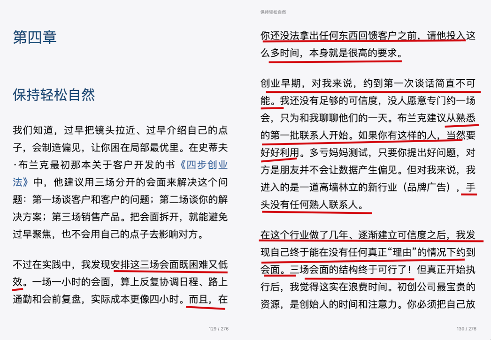

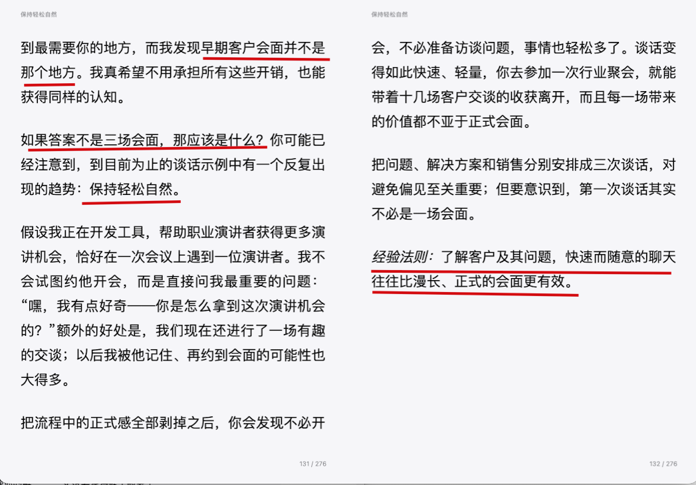

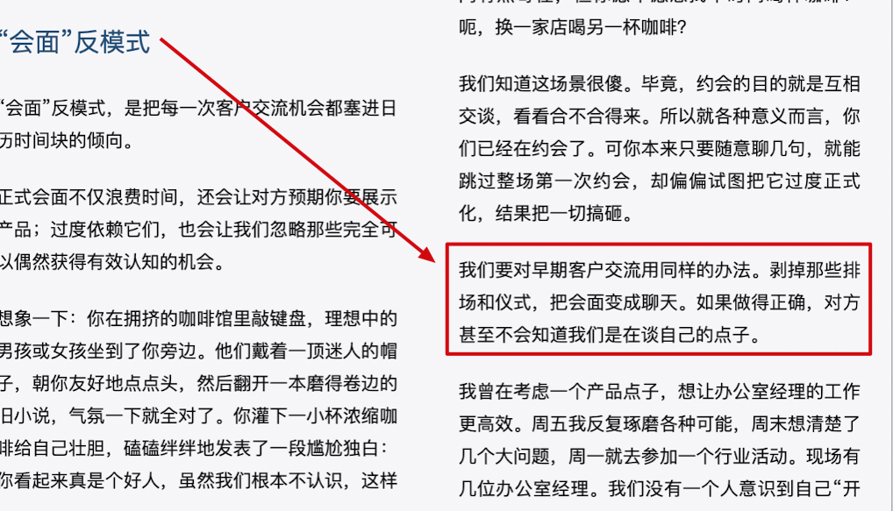

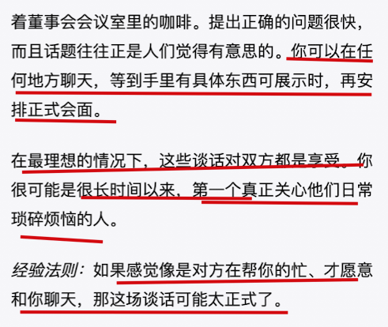

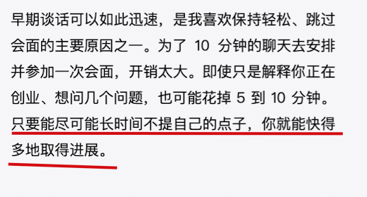

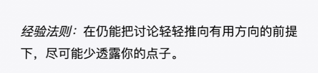

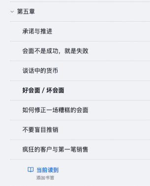

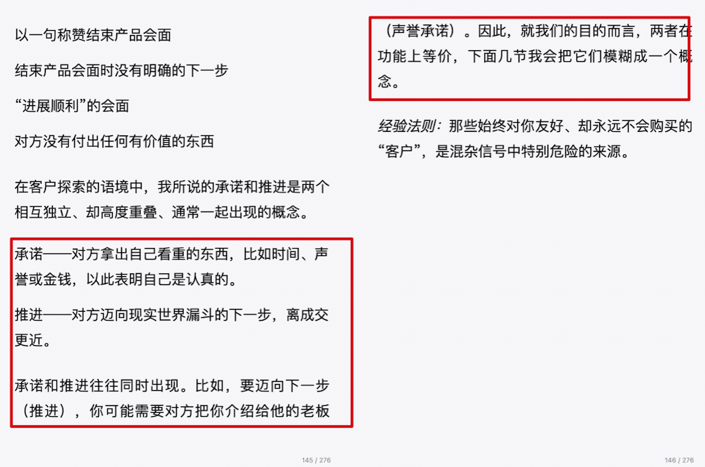

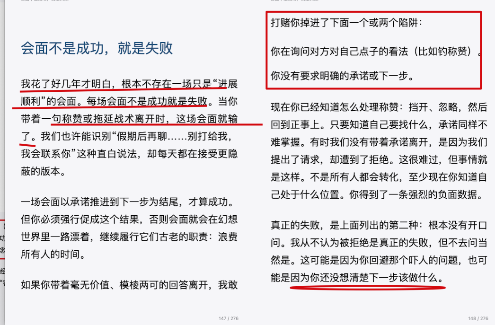

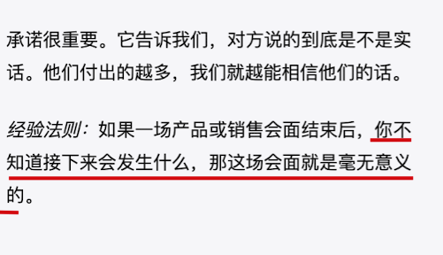

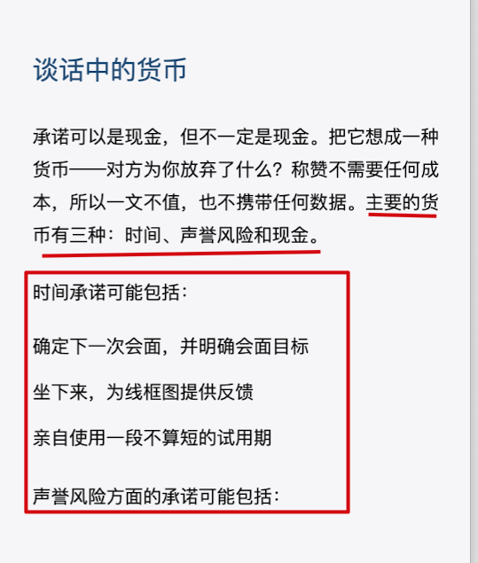

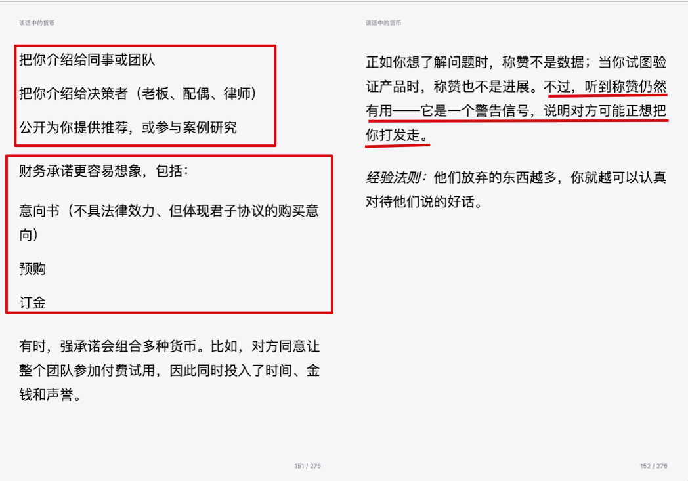

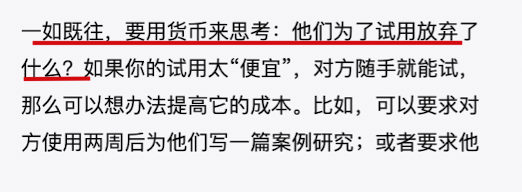

要思考他们放弃了什么

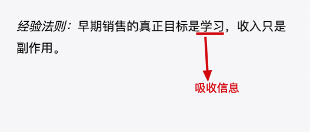

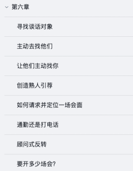

## 目录

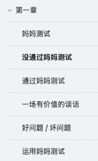

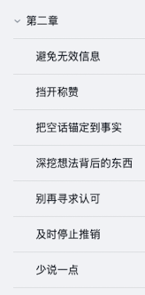

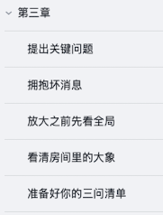

## 其它书籍：

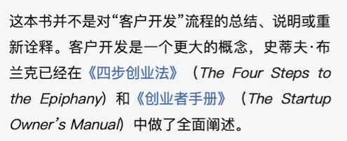
