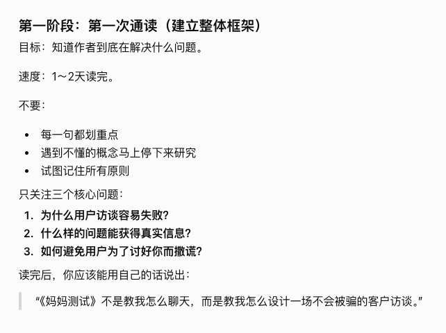

本书的核心目标：教会我们如何正确地跟客户交谈，并得到真实需求。正确的交谈就是提出好问题

为什么用户访谈容易失败？因为问的问题不对，导致获得了很多“假正面”的信号

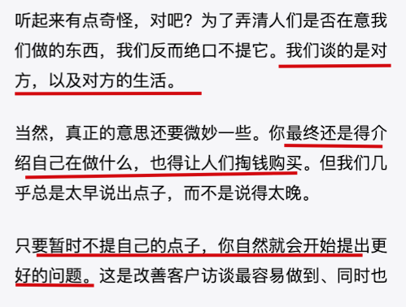

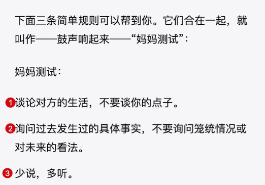

可以搜集一些好问题和坏问题，正反面的问题，以及我们要通过这个问题和行为得到什么信息

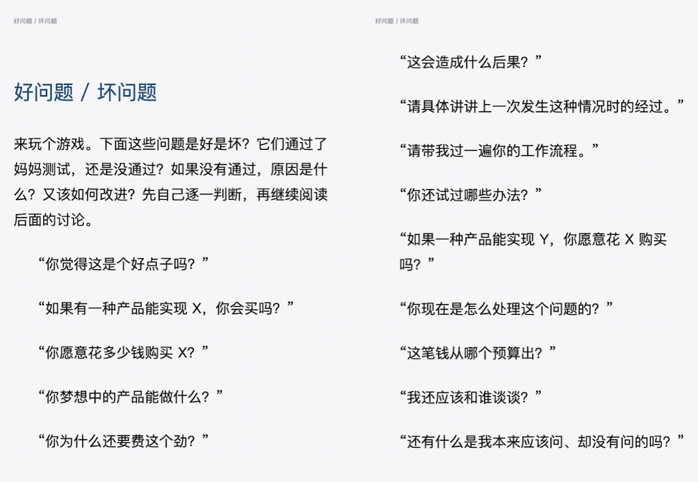

直接演示，聊问题、发现潜在需求

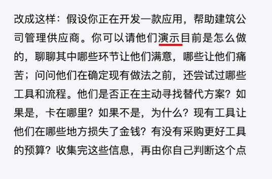

聊潜在需求到底算不算真实需求，判断他们愿不愿意花钱

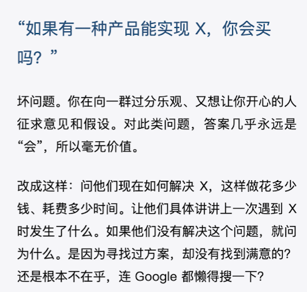

聊真实需求的预算

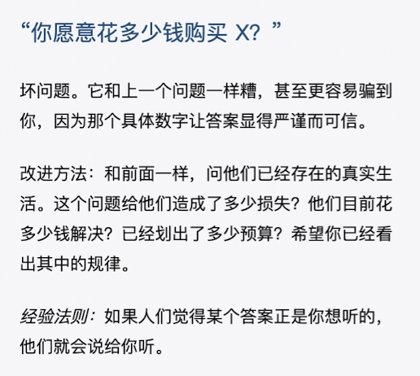

直接要需要，判断其背后的真实需求

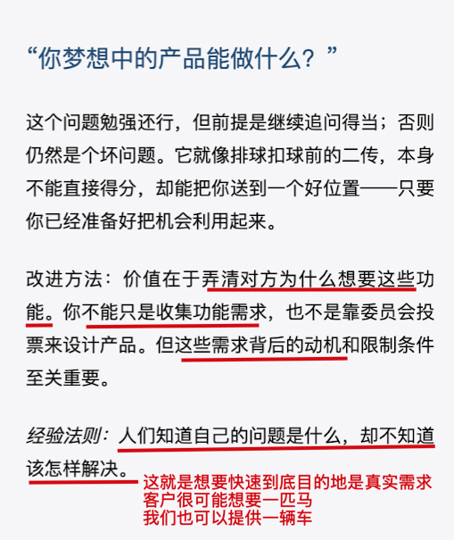

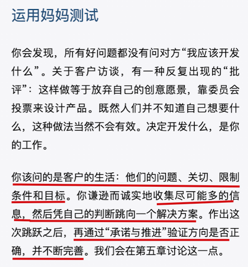

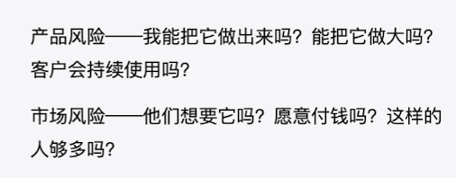

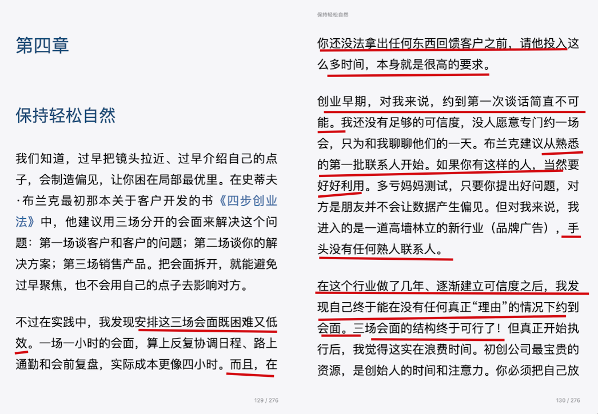

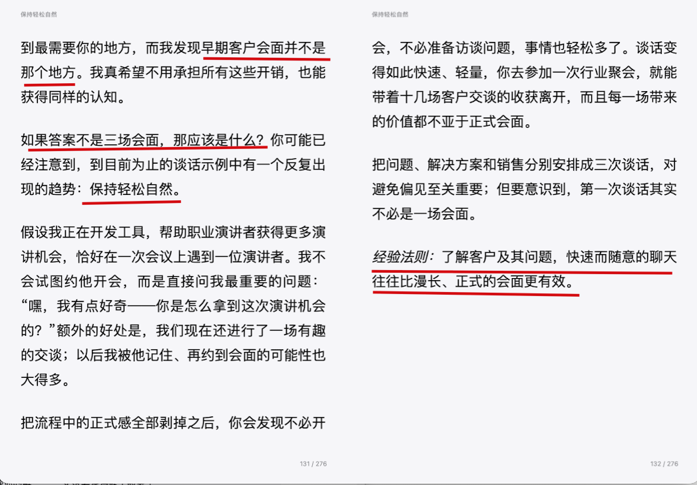

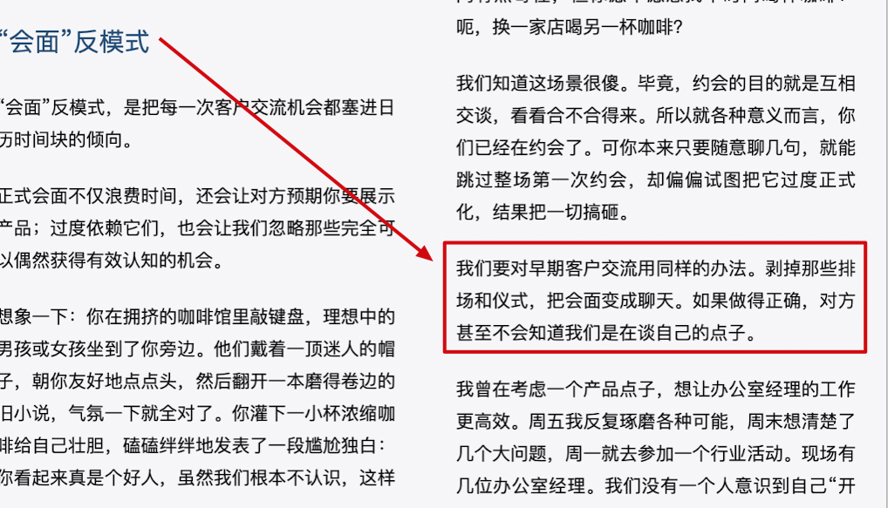

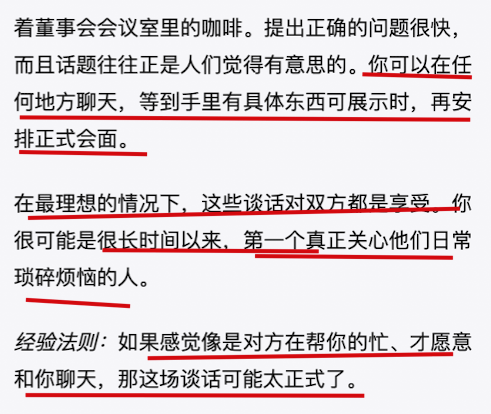

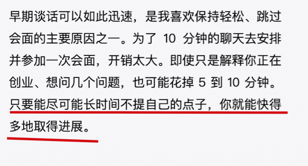

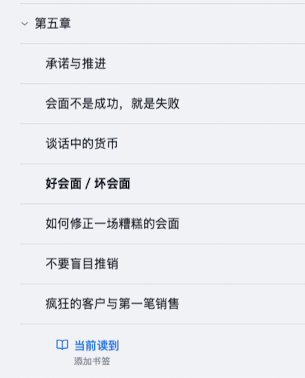

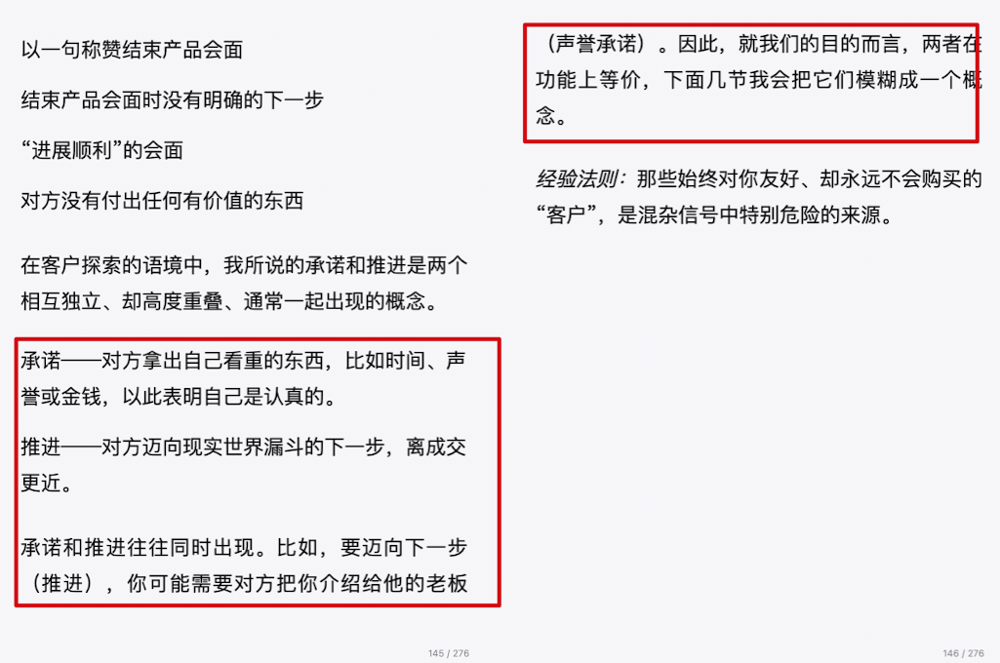

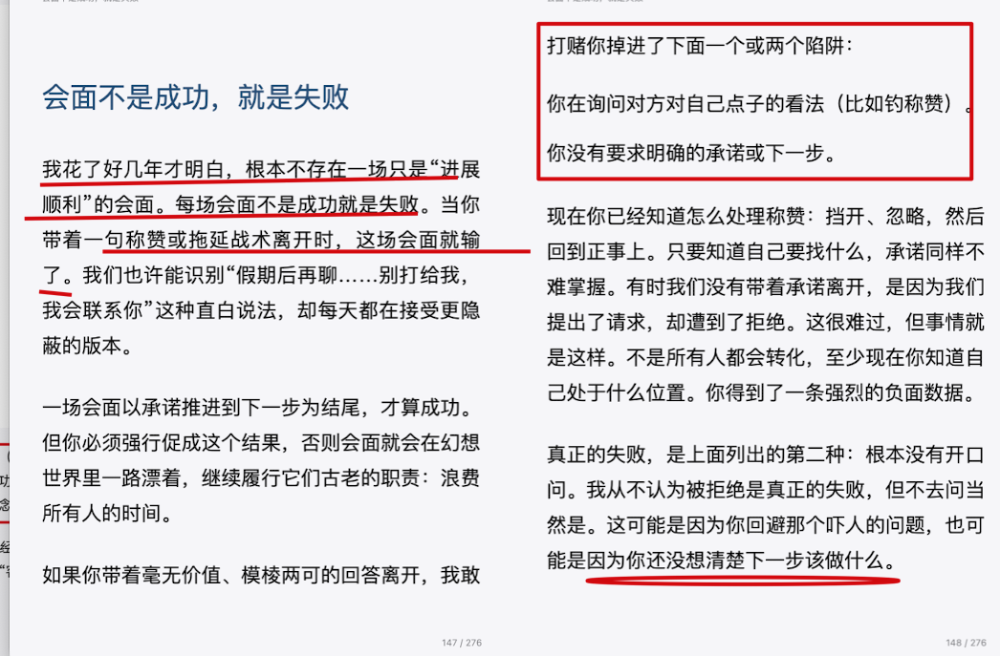

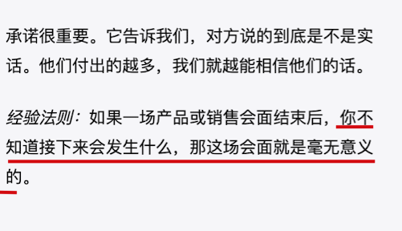

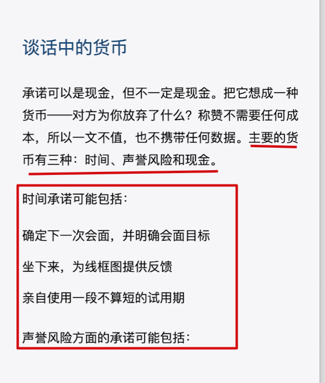

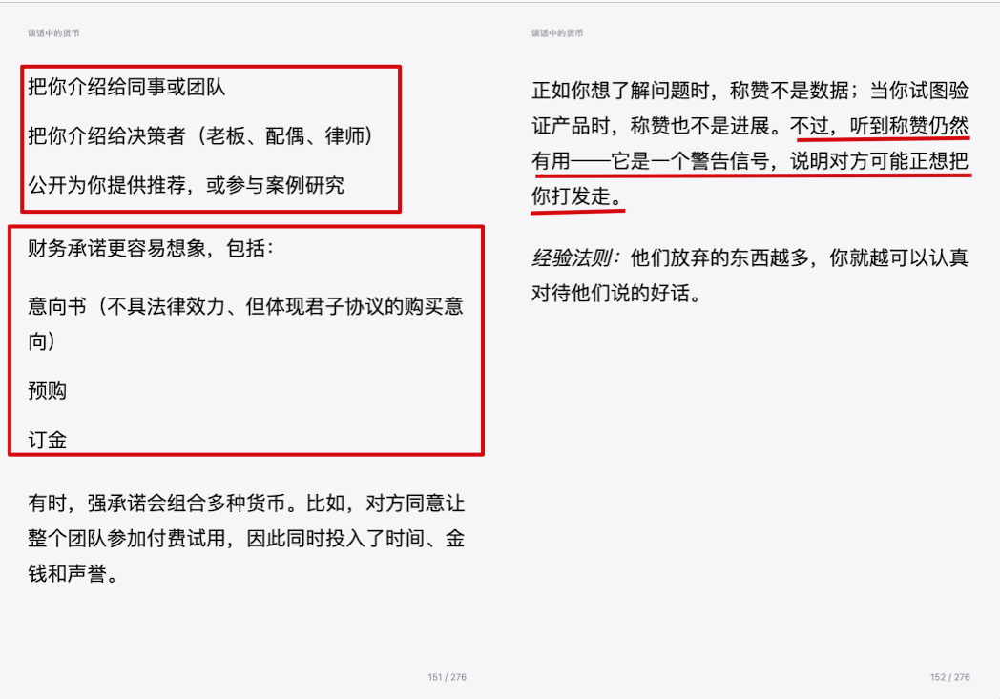

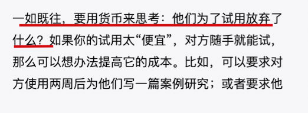

要思考他们放弃了什么

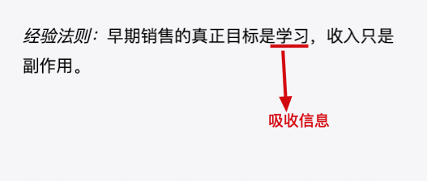

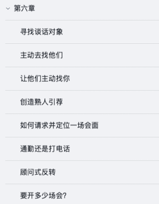

## 目录

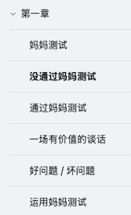

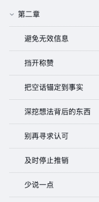

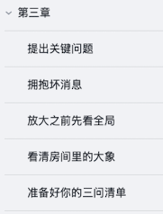

## 其它书籍：

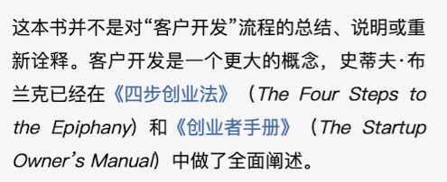
